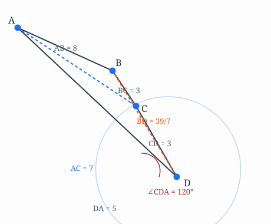

今日学段：**几何 + 数论**（AMC 10/12 难度）

题目来源：2024 AMC 12A 竞赛真题（AoPS / 公开题库 songsjun/AMC12_Problems）

---

## 【几何】圆内接四边形的短对角线

**难度：** ⭐⭐⭐⭐（高中竞赛 · 圆内接四边形、余弦定理、托勒密定理）

**题目来源：** [2024 AMC 12A Problem 19](https://raw.githubusercontent.com/songsjun/AMC12_Problems/main/2024_AMC_12A_Problems/Problem_19.md)

**知识点：** 圆内接四边形对角互补 · 余弦定理 · 托勒密定理

**题目：**

圆内接四边形 $ABCD$ 中，已知 $BC=CD=3$，$DA=5$，且 $\angle CDA=120^\circ$。求 $ABCD$ 较短的对角线之长。

$$
\textbf{(A) }\frac{31}7 \qquad \textbf{(B) }\frac{33}7 \qquad \textbf{(C) }5 \qquad \textbf{(D) }\frac{39}7 \qquad \textbf{(E) }\frac{41}7
$$

---

### 解题过程

**第一步：利用圆内接四边形的性质求 $\angle CBA$。**

四边形 $ABCD$ 内接于圆，对角互补：
$$
\angle CBA + \angle CDA = 180^\circ \quad\Rightarrow\quad \angle CBA = 180^\circ - 120^\circ = 60^\circ.
$$

**第二步：在 $\triangle ACD$ 中用余弦定理求对角线 $AC$。**

$$
\begin{aligned}
AC^2 &= CD^2 + DA^2 - 2\cdot CD\cdot DA\cdot \cos 120^\circ \\
&= 3^2 + 5^2 - 2\cdot 3\cdot 5\cdot\left(-\tfrac12\right) \\
&= 9 + 25 + 15 = 49,
\end{aligned}
$$
故 $AC = 7$。

**第三步：在 $\triangle ABC$ 中用余弦定理求边 $AB$。**

$$
\begin{aligned}
AC^2 &= AB^2 + BC^2 - 2\cdot AB\cdot BC\cdot \cos 60^\circ \\
49 &= AB^2 + 9 - 2\cdot AB\cdot 3\cdot \tfrac12 \\
49 &= AB^2 - 3AB + 9 \\
AB^2 - 3AB - 40 &= 0.
\end{aligned}
$$
解得 $AB = \dfrac{3 \pm 13}{2}$，取正值 $AB = 8$。

**第四步：用托勒密定理求另一条对角线 $BD$。**

圆内接四边形满足：
$$
AB\cdot CD + AD\cdot BC = AC\cdot BD.
$$
代入数值：
$$
8\cdot 3 + 5\cdot 3 = 7\cdot BD \quad\Rightarrow\quad 24 + 15 = 7BD \quad\Rightarrow\quad BD = \frac{39}{7}.
$$

**第五步：比较两条对角线。**

$AC = 7 = \dfrac{49}{7} > \dfrac{39}{7} = BD$，故较短的对角线为
$$
\boxed{\textbf{(D) }\frac{39}{7}}.
$$

---

### 常见错误

- **忽略"较短"二字**：求出两条对角线后直接选 $AC=7$，但 $BD=\frac{39}{7}\approx 5.57$ 更短，应选 $BD$。
- **误用对角互补**：把 $\angle CBA$ 当成 $120^\circ$ 的邻角而算错余弦符号，导致 $AC$ 长度错误。
- **托勒密定理写反**：记成 $AB\cdot BC + AD\cdot CD = AC\cdot BD$，乘积配对错误。

---

### 知识背景

圆内接四边形（cyclic quadrilateral）是指四个顶点都在同一个圆上的四边形。它有两条核心性质：一是**对角互补**（相对两角之和为 $180^\circ$），二是**托勒密定理**——两对对边乘积之和等于两条对角线乘积。这类问题常把"余弦定理求边长"与"圆内接性质"结合，是 AMC 12 几何高频题型。掌握托勒密定理能在已知三边及一角时，快速绕过复杂的坐标或三角恒等变换直接拿到对角线。

---

## 【数论】最大整数与完全平方数

**难度：** ⭐⭐⭐（高中竞赛 · 完全平方数、因式分解、同余）

**题目来源：** [2024 AMC 12A Problem 9](https://raw.githubusercontent.com/songsjun/AMC12_Problems/main/2024_AMC_12A_Problems/Problem_09.md)

**知识点：** 完全平方数 · 平方差分解 · 奇偶性 · 模 10 同余

**题目：**

设 $M$ 是满足 $M+1213$ 与 $M+3773$ 均为完全平方数的**最大整数**。求 $M$ 的个位数。

$$
\textbf{(A) }1\qquad\textbf{(B) }2\qquad\textbf{(C) }3\qquad\textbf{(D) }6\qquad\textbf{(E) }8
$$

---

### 解题过程

**第一步：设未知数并列方程。**

设 $M+1213 = P^2$，$M+3773 = Q^2$（$P,Q$ 为正整数）。两式相减：
$$
Q^2 - P^2 = 3773 - 1213 = 2560.
$$
平方差分解：
$$
(Q+P)(Q-P) = 2560.
$$

**第二步：分析奇偶性与最大化条件。**

$Q+P$ 与 $Q-P$ 同奇偶，且 $Q+P > Q-P$。要让 $M$ 最大，就需要 $P,Q$ 尽可能大，即让 $Q+P$ 最大、$Q-P$ 最小。由于两者同奇偶且乘积为偶数 $2560$，最小的正偶数差为 $2$。

取
$$
Q+P = 1280,\qquad Q-P = 2,
$$
解得 $(P,Q) = (639, 641)$。

**第三步：求 $M$ 的个位数（无需算完整 $M$）。**

$$
M = P^2 - 1213 = 639^2 - 1213.
$$
只需看个位数：
$$
639^2 \text{ 个位 } = 9^2 \text{ 个位 } = 1,\qquad 1213 \text{ 个位 } = 3.
$$
故 $M$ 的个位为 $1 - 3 \equiv 8 \pmod{10}$。

$$
\boxed{\textbf{(E) }8}.
$$

> 验证：$639^2 = 408321$，$M = 408321 - 1213 = 407108$；$407108 + 3773 = 410881 = 641^2$，成立。

---

### 常见错误

- **忘记"最大"条件**：随便取一组因子分解就停手，没用"差最小"来最大化 $M$，可能误判个位数。
- **奇偶性陷阱**：认为两平方数可以相差 $1$（连续平方），但 $P,Q$ 同奇偶（因为 $P^2,Q^2$ 同奇偶），差至少为 $2$。
- **直接计算大数**：硬算 $639^2-1213$ 再取个位，容易算错；直接用模 $10$ 更快更稳。

---

### 知识背景

本题是"差为定值的完全平方数"经典题型。核心技巧是把 $Q^2-P^2 = N$ 分解为 $(Q+P)(Q-P)=N$，再利用两因子同奇偶的性质枚举。由于 $M$ 只关心个位数，全程可用**模 10 同余**跳过庞大的具体数值计算——这正是竞赛中"只问末位/某位数字"类问题的标准省力打法。类似的思路也常用于 AMC 中关于完全平方数的存在性与最值问题。
